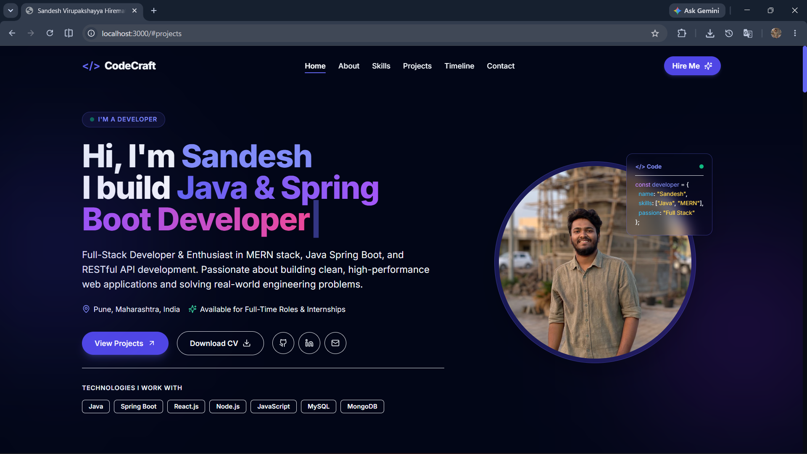
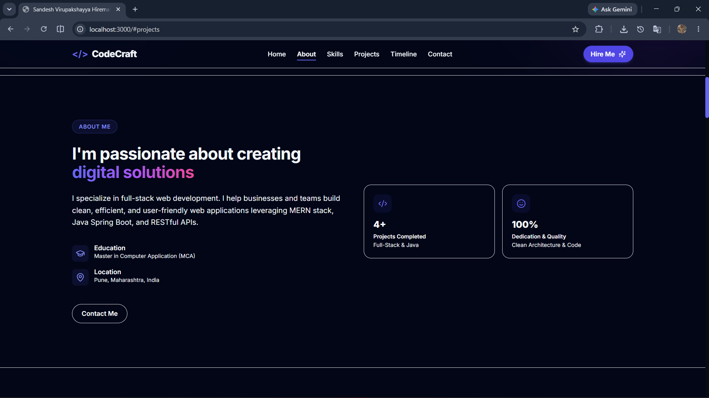
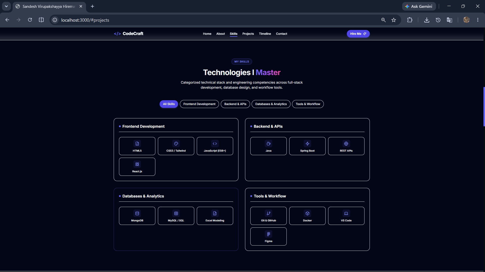
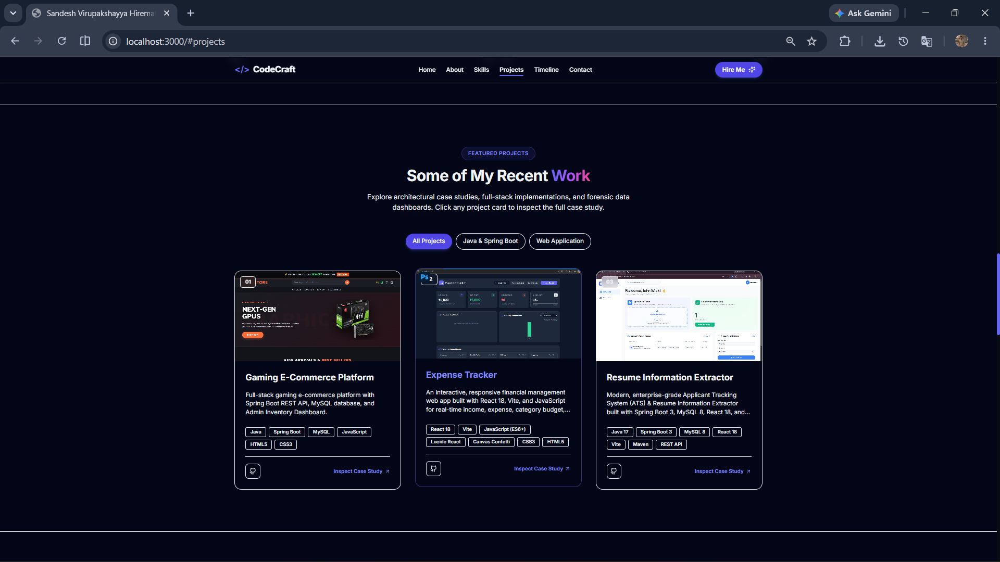
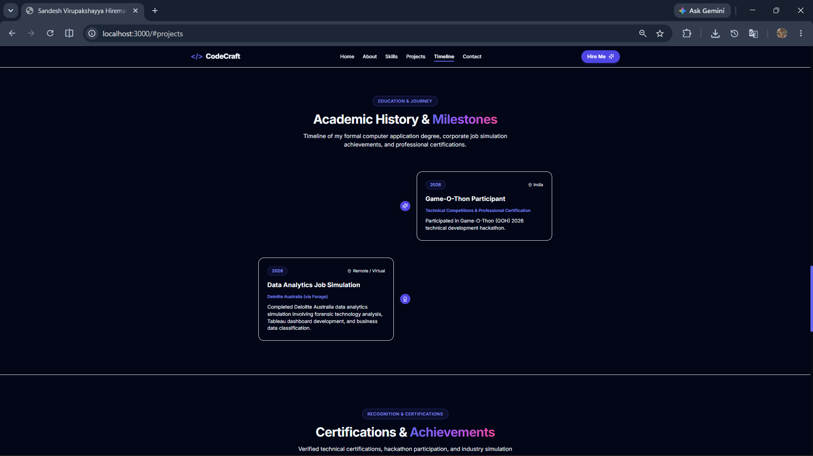
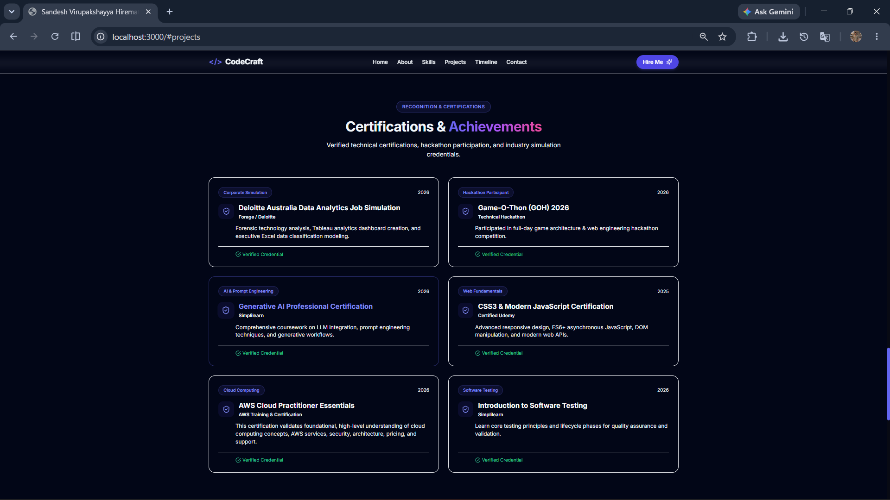
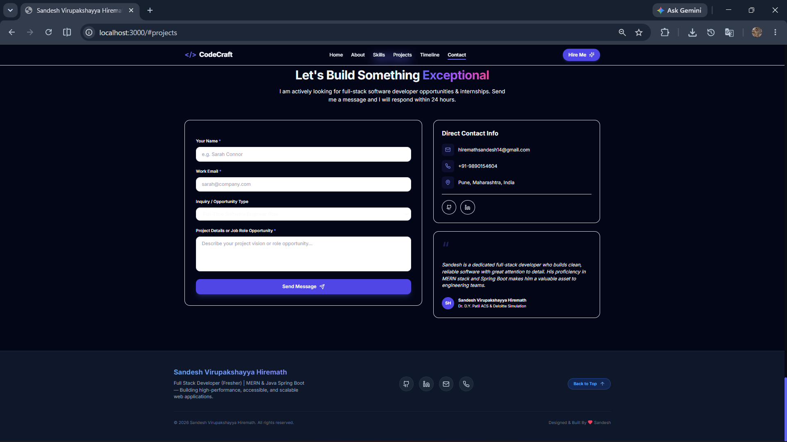
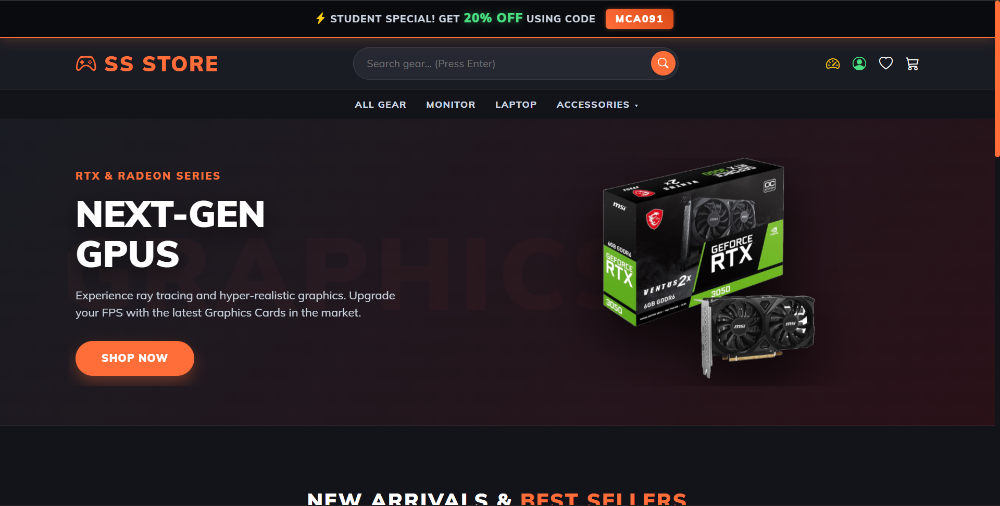
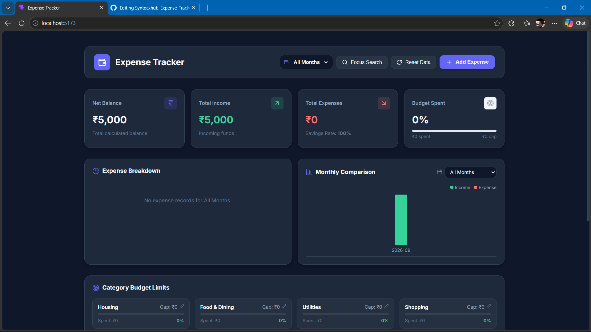
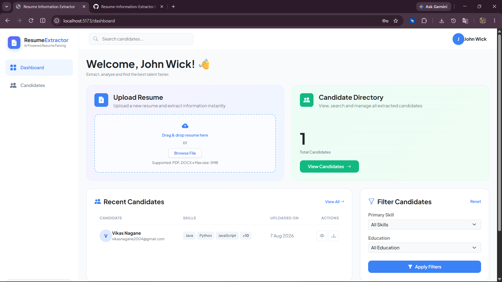

# 🚀 Sandesh Hiremath — Personal Portfolio & Technical Case Studies

[](https://nextjs.org/)
[](https://www.typescriptlang.org/)
[](https://tailwindcss.com/)
[](https://react.dev/)
[](LICENSE)

Production-ready, modern Full Stack Developer Portfolio & Technical Case Studies website built for **Sandesh Virupakshayya Hiremath** (Full Stack Developer & Java Spring Boot Enthusiast based in Pune, India).

---

## 📸 Portfolio UI Section Screenshots

### 1. Hero Section Banner
Typewriter role animation, personal summary, location, availability badge, call-to-action buttons (`View Projects`, `Download CV`), and interactive code card overlay.



---

### 2. About Me & Education
Developer background summary, location, and quick fact cards.



---

### 3. Technical Skills & Expertise
Categorized skill badges across Frontend, Backend & APIs, Databases & Analytics, and Tools & Workflow.



---

### 4. Featured Projects Grid
Interactive project cards with category filter tabs (`All Projects`, `Java & Spring Boot`, `Web Application`) and case study links.



---

### 5. Milestones & Experience Timeline
Chronological timeline of education.



---

### 6. Certifications & Achievements
Verified industry certifications including Deloitte Australia Data Analytics Simulation, Game-O-Thon 2026, Simplilearn Generative AI, CSS/JS, and AWS Cloud Practitioner Essentials.



---

### 7. Footer & Quick Links
Footer layout with social profile links (GitHub, LinkedIn, Email), brand logo, and smooth back-to-top navigation.



---

## 🛠️ Featured Projects & Case Studies

### 1. Gaming E-Commerce Platform
- **Repository**: [S-S-GearZone-Website](https://github.com/CommitWithSandy/S-S-GearZone-Website.git)
- **Tech Stack**: `Java`, `Spring Boot`, `MySQL`, `JavaScript`, `HTML5`, `CSS3`
- **Key Features**:
  - Full-stack gaming e-commerce catalog, shopping cart, and session authentication.
  - Comprehensive Admin Dashboard for product, inventory, and order status management.



---

### 2. Expense Information Tracker
- **Repository**: [Expense-Tracker](https://github.com/CommitWithSandy/Expense-Tracker.git)
- **Tech Stack**: `React 18`, `Vite`, `JavaScript (ES6+)`, `Lucide React`, `Canvas Confetti`, `CSS3`
- **Key Features**:
  - KPI Financial Summary Cards (Net Balance, Income, Expenses, Savings Rate %, Budget Cap progress).
  - Global Month Filter & Category Budget Manager with limit tracking.
  - Analytics charts, transaction search/filter/sorting presets, and confetti income micro-animations.



---

### 3. Resume Information Extractor
- **Repository**: [Resume-Information-Extractor](https://github.com/CommitWithSandy/Resume-Information-Extractor.git)
- **Tech Stack**: `Java 17`, `Spring Boot 3`, `MySQL 8`, `React 18`, `Vite`, `Maven`, `REST API`
- **Key Features**:
  - Format-Independent Resume Parsing Engine (universal template support for Canva, LinkedIn, Europass, Word, PDFs without hallucinations).
  - Multi-Project Splitting Engine with automated boundary detection.
  - Candidate record isolation via Spring Security & MySQL relational foreign keys.



---

## 🛠️ Tech Stack & Architecture

- **Frontend**: Next.js 14 (App Router), React 18, TypeScript, Tailwind CSS, Framer Motion, Lucide React
- **Backend**: Next.js Serverless API Routes, Node.js, Nodemailer (SMTP)
- **Database**: MongoDB Atlas (Mongoose ORM)
- **Validation & Security**: Zod Validation, Honeypot Anti-Spam, Rate Limiting
- **SEO & Performance**: OpenGraph Metadata, JSON-LD `Person` Schema, `sitemap.xml`, `robots.txt`

---

## 📁 Directory Structure

```text
├── app/
│   ├── api/
│   │   ├── contact/route.ts      # Contact form POST handler
│   │   └── projects/route.ts     # Projects JSON API endpoint
│   ├── projects/
│   │   └── [slug]/page.tsx       # Dynamic project case study route
│   ├── globals.css               # Tailwind & CSS variables
│   ├── layout.tsx                # Root layout with metadata & PersonSchema
│   └── page.tsx                  # Main single-page portfolio layout
├── components/
│   ├── About.tsx                 # Bio & education facts
│   ├── Certifications.tsx        # Verified certificates grid
│   ├── ContactForm.tsx           # Interactive contact form
│   ├── Footer.tsx                # Footer with socials
│   ├── Hero.tsx                  # Animated typewriter hero & CV download
│   ├── Navbar.tsx                # Sticky blurred navigation
│   ├── Projects.tsx              # Projects grid with category filtering
│   ├── Skills.tsx                # Categorized skill tags
│   └── Timeline.tsx              # Education & Internship timeline
├── data/
│   └── portfolio.ts              # All personal details, projects & experience
├── assets/                       # UI screenshots & project images
└── public/                       # Static web assets & resume.pdf
```

---

## 🚀 Quick Start & Local Setup

### 1. Clone the Repository
```bash
git clone https://github.com/CommitWithSandy/personal-portfolio.git
cd personal-portfolio
```

### 2. Install Dependencies
```bash
npm install
```

### 3. Configure Environment Variables
Copy `.env.example` to `.env.local`:
```bash
cp .env.example .env.local
```

### 4. Run Development Server
```bash
npm run dev
```
Open [http://localhost:3000](http://localhost:3000) in your browser.

---

## 📬 Contact & Connect

- **Name**: Sandesh Virupakshayya Hiremath
- **Email**: hiremathsandesh14@gmail.com
- **Phone**: +91-9890154604
- **Location**: Pune, Maharashtra, India
- **GitHub**: [github.com/CommitWithSandy](https://github.com/CommitWithSandy)
- **LinkedIn**: [linkedin.com/in/sandesh-hiremath/](https://linkedin.com/in/sandesh-hiremath/)

---

## 📜 License

This project is open-source under the [MIT License](LICENSE).
